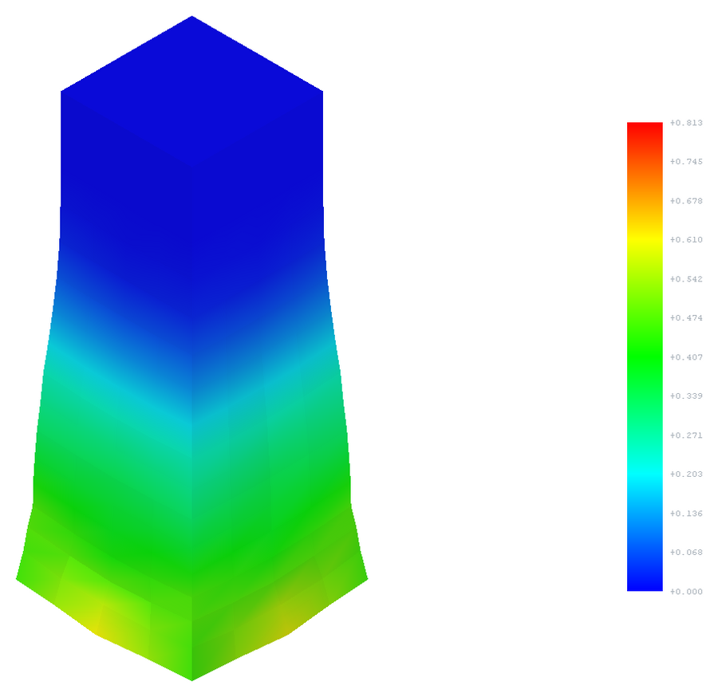
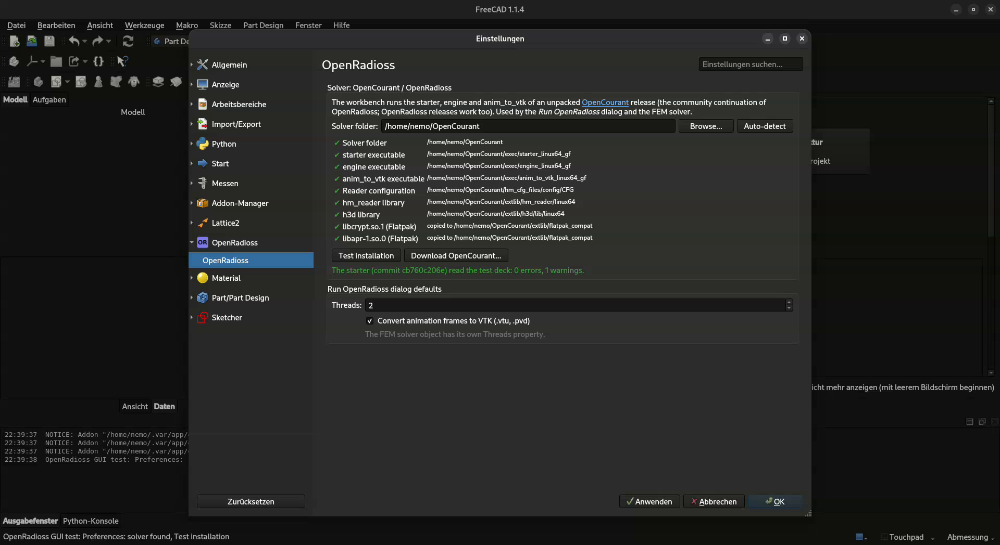
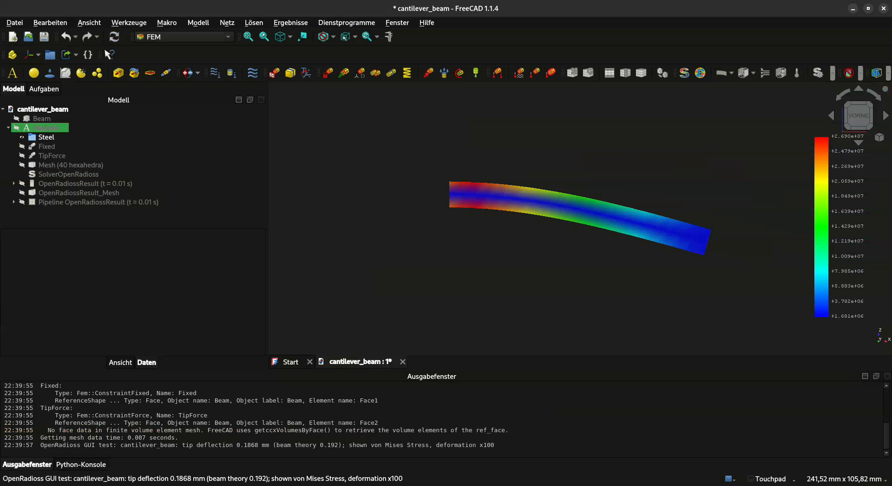
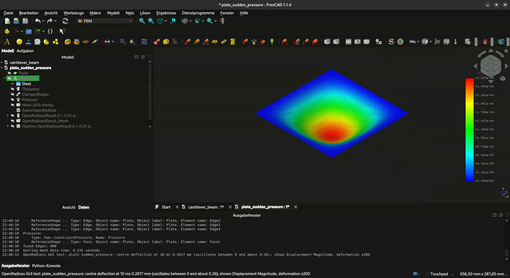
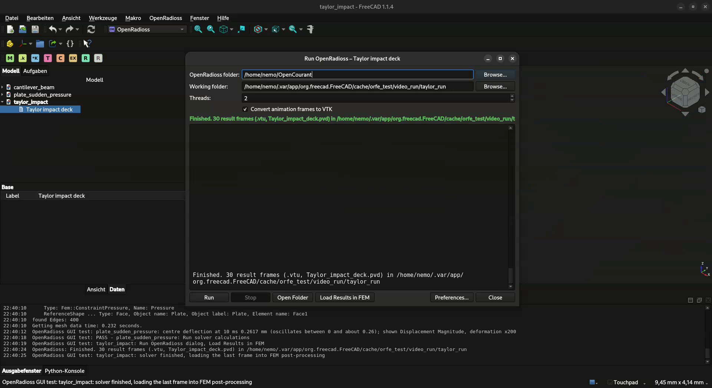
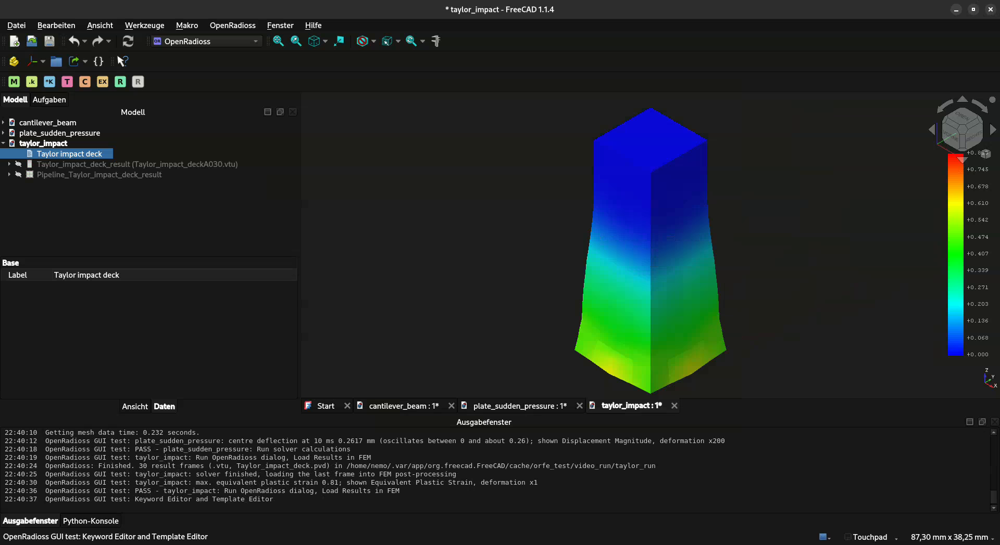
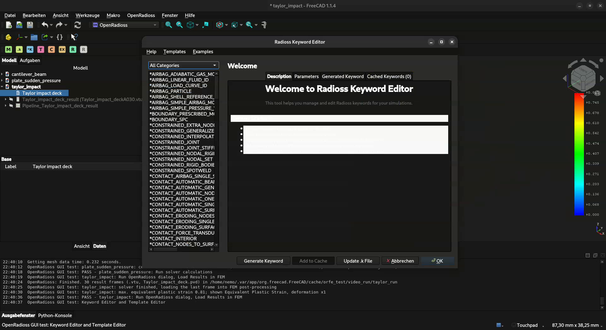

# FC_OpenCourant – OpenCourant / OpenRadioss workbench for FreeCAD

Explicit dynamics (impact, crash, drop tests, sudden loads) in FreeCAD with
[OpenCourant](https://github.com/OpenCourant/OpenCourant), the community continuation of OpenRadioss:
as a solver of the **FEM workbench**, and as an **LS-DYNA keyword deck** (`.k`) workbench with editor,
templates and a run dialog. Package name `ORfemn`, workbench name *OpenRadioss*.

**[Installation](INSTALL.md)** · **[Testing](TESTING.md)** · [Overview page](docs/index.html) (open locally, or enable GitHub Pages
for `/docs`) · [Introduction (PDF)](docs/ORfe_Introduction.pdf) ·
[Examples](examples/) · [Screenshots and video](#screenshots-and-video) ·
[Example analysis (PDF, AI-generated, not human-verified)](docs/ORfe_Example_Analysis.pdf)



## Installation in short

1. FreeCAD 1.0 or newer.
2. Workbench: paste the one-liner from [INSTALL.md](INSTALL.md) into FreeCAD's Python console (any OS), or
   `git clone https://github.com/CalzitPLA/FC_OpenCourant` into FreeCAD's `Mod` folder; restart FreeCAD.
3. Solver: **Edit → Preferences → OpenRadioss → Download OpenCourant...** (Linux, Windows; there is no
   macOS release), then **Test installation**.
4. Test it: **[TESTING.md](TESTING.md)** – a one-minute check with the cantilever example, or the
   automatic GUI test with one command.

[INSTALL.md](INSTALL.md) has the commands for Linux, Windows and macOS and a troubleshooting table.
The OpenRadioss project was discontinued in October 2026; OpenCourant releases have the same layout and
executable names, so older OpenRadioss releases work too.

## How it fits into FreeCAD: two ways in

| | FEM workbench | OpenRadioss workbench (keyword deck) |
|---|---|---|
| You work with | an ordinary FEM analysis: mesh, material, constraints, *Solver OpenRadioss* | an LS-DYNA keyword text object (`.k` deck) |
| The deck is | written by the workbench from the analysis (nodes, elements, materials, loads) | written by you: Keyword Editor, templates or plain text |
| Run with | *Run solver calculations* (FEM solver framework) | *Run OpenRadioss* dialog (live log, Stop) |
| Covers | linear elastic solids and shells, fixed/displacement constraints, force, pressure, self weight | everything the OpenCourant LS-DYNA reader supports (contact, plasticity, rigid walls, initial velocities, ...) |
| Results | FEM result + pipeline in the analysis | FEM result + pipeline on *Load Results in FEM* |

Both use the same solver settings (*Edit → Preferences → OpenRadioss*), run the same three steps
(starter, engine, `anim_to_vtk`), and load results the same way: displacement, stresses, equivalent
plastic strain; all frames as a `.pvd` series for ParaView. The two meet in the FEM solver's
*AdditionalKeywords* property: a keyword text object whose keywords are appended to the generated deck.

## Using the OpenRadioss workbench

Toolbar and menu of the *OpenRadioss* workbench:

- **Create Radioss Model** – new document with groups for parts, materials, loads, ...
- **Create Basic .k File** – adds a small, runnable single-shell deck as a text object
- **Keyword Editor** – browse keywords, fill in card fields, cache generated keywords,
  or start from a template (*Templates* menu); **Update .k File** writes the cache into the document
- **Template Editor** – create, edit, duplicate, delete and reorder the templates of the
  *Templates* menu, with a live preview (also under *Templates → Edit Templates...* in the Keyword Editor)
- **Open Cache Viewer** – inspect/remove cached keywords of the open editor
- **Export LS-DYNA .k File** – save a text object to a `.k` file
- **Run OpenRadioss** – run starter, engine and the VTK conversion on a keyword text object in the
  background (live log, Stop), then load the result into FEM post-processing. All frames are written
  as `.vtu` plus a `.pvd` series for ParaView. Inside the FreeCAD Flatpak the two host libraries the
  solver needs (`libcrypt.so.1`, `libapr-1.so.0`) are copied to `<solver folder>/extlib/flatpak_compat`.
- **OpenRadioss Preferences...** (menu) – solver folder, requirements check, OpenCourant download

## OpenRadioss in the FEM workbench

OpenRadioss is also available as a solver of FreeCAD's **FEM workbench** (*Solve* toolbar and menu:
**Solver OpenRadioss**, next to CalculiX, Elmer, Mystran and Z88). Set up an analysis as usual
(mesh, material, constraints), add the solver and run it with *Run solver calculations* or by
double-clicking the solver. The last frame appears as a FEM result (displacement, von Mises and
principal stresses, like CalculiX results) plus a post-processing pipeline in the analysis; all frames are in the working directory as `radioss.pvd` for ParaView.

OpenRadioss is an **explicit dynamic** solver. Solver properties:

| Property | Meaning |
|---|---|
| EndTime | simulated time (default 0.01 s); explicit time steps are tiny, so keep it short |
| LoadCurve | *Ramp* (loads grow from 0 over EndTime, quasi-static) or *Constant* (impact-like) |
| OutputFrames | number of result frames |
| MassScalingMicroseconds | 0 = off; otherwise mass is added so the time step stays at least this value in µs (much faster, e.g. 0.2) |
| Threads | threads for starter and engine |
| AdditionalKeywords | a text document whose keywords are appended to the deck (e.g. from the Keyword Editor) |

Supported: volume meshes (tetra4, tetra10 native, hexa8, penta6, pyra5; second-order hexa/penta/pyra
are reduced to corner nodes) and face meshes with a shell thickness; linear elastic materials (several
via references); fixed and displacement (fixed components) constraints, force, pressure and self weight.
Results contain displacements, stresses and, for plastic materials, the equivalent plastic strain.
Other constraints are reported and ignored. For bending with hexahedra use at least two elements
through the thickness.

**Known solver limitation (tetra10):** in a cantilever test with OpenCourant `latest-20261011` the
10-node tetrahedron deflected about 35 % more than CalculiX on the same mesh, and the starter reports
only 0.70 of the physical mass for tetra10 meshes. Hexahedra (+0.4 % vs. beam theory) and linear
tetrahedra (within 2–9 % of CalculiX) agree. The deck's tetra10 node order was checked against the
starter, so this comes from the solver element; use hexahedra or a fine tetra4 mesh for quantitative
results. Mass scaling can also add a lot of mass for tetra10 meshes: check *MASS ADDED* in
`radioss_0001.out`.

The default templates live in `freecad/ORfemn/templates.json` and use consistent mm / t / s / N / MPa units.
Templates edited in the Template Editor are saved per user to `<FreeCAD user data>/ORfemn/templates.json`
(e.g. `~/.local/share/FreeCAD/ORfemn/`), which then replaces the defaults; *Reset to Defaults* removes it.

## Examples

| File | Workflow | Result |
|---|---|---|
| [`examples/cantilever_beam.FCStd`](examples/) | FEM workbench, hexahedra, ramp load | tip deflection 0.187 mm (beam theory 0.192 mm) |
| [`examples/plate_sudden_pressure.FCStd`](examples/) | FEM workbench, shells, sudden pressure | oscillation around the static plate deflection with about twice its peak |
| [`examples/taylor_impact.FCStd`](examples/) | keyword deck, Run OpenRadioss dialog | plastic bar hitting a rigid wall at 200 m/s |

See [`examples/README.md`](examples/README.md) for how to run them.

## Screenshots and video

Taken from a recording of the GUI test (`tests/run_gui_test.sh --record`) in FreeCAD 1.1.4;
full video (70 s, no sound): [`docs/video/freecad_gui_test.mp4`](docs/video/freecad_gui_test.mp4).

| | |
|---|---|
|  Edit → Preferences → OpenRadioss: solver found, requirements met, Test installation passed |  Cantilever (FEM workbench): von Mises stress, deformation ×100 |
|  Plate under sudden pressure (shells), deformation ×200 |  Run OpenRadioss dialog after the Taylor impact run |
|  Taylor impact: equivalent plastic strain |  Keyword Editor |

## Repository layout

| Path | Contents |
|---|---|
| `freecad/ORfemn/` | The workbench package (the only part that gets installed) |
| `tests/` | `tests.py`: unit tests for the FreeCAD-independent code; `freecad_gui_test.py`: GUI test inside FreeCAD; `run_gui_test.sh`: runs it (and records it with `--record`) |
| `examples/` | Example documents and the script that builds them |
| `tools/keyword_db/` | Scripts that build `keywords_with_parameters.json`: `download_docs.py` (fetch the current Radioss LS-DYNA keyword docs into `data/docs/`), then `extract_cards.py` (card layouts, options, links; also runs `extract_field_info.py` for defaults and descriptions) |
| `tools/examples/` | Scripts that download dynaexamples.com and extract `.k` files into `data/examples/` |
| `tools/legacy/` | Old code kept for reference; not loaded by the workbench |
| `data/` | Keyword list. The scraped Altair Radioss documentation (`data/docs/`, `data/local_documentation/`, `data/Keyword documentation/`), keyword database archives (`data/archiv/`) and examples (`data/examples/`) are not tracked by git; the scripts in `tools/` download or rebuild them |
| `docs/` | Introduction (`ORfe_Introduction.tex/.pdf`), example analysis (`ORfe_Example_Analysis.tex/.pdf`, AI-generated, not human-verified), `images/`, `screenshots/`, `video/`, older workflow documentation |

## Tests

How to check an installation (quick check, GUI test, expected output, reporting): [TESTING.md](TESTING.md).

```shell
python tests/tests.py                                         # or: pixi run test
tests/run_gui_test.sh                                         # GUI test in FreeCAD (--flatpak, --native)
tests/run_gui_test.sh --flatpak --record test.mp4             # ... and record it (GNOME screencast)
FreeCAD tests/freecad_gui_test.py                             # GUI test directly, exits with 0 on success
```

`tests.py` covers the FreeCAD-independent code: `.k` formatting, templates, deck writer, result
conversion, solver detection, requirements check and release download/unpacking. Three tests run the
real solver and are skipped when none is found. `freecad_gui_test.py` drives FreeCAD like a user: the
preference page (*Test installation*), *Run solver calculations* on the two FEM examples, the *Run
OpenRadioss* dialog with *Load Results in FEM* on the Taylor impact, and the editors; it writes a report
and screenshots to `$ORFE_OUT` (default `~/orfe_gui_test_<date>`).

## License and no warranty

LGPL-2.1-or-later, like FreeCAD (see [LICENSE](LICENSE)). OpenRadioss and OpenCourant are separate
programs under the AGPL-3.0; the workbench only runs their executables.

**No warranty.** The workbench, the examples and the documents are provided "as is", without warranty
of any kind. Simulation results must be checked by a qualified engineer before they are relied on. The
example analysis (`docs/ORfe_Example_Analysis.pdf`) was generated by an AI model and has not been
verified by a human.

## Maintainer

Nicholas Herrmann
nicholas.herrmann@proton.me
