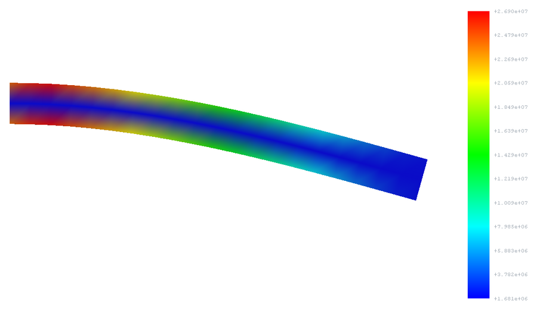
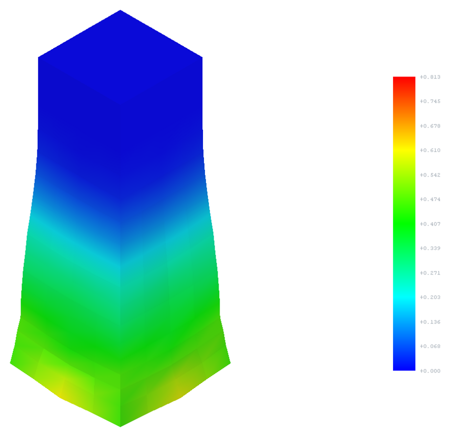

# Examples

Three small models, each solved in a few seconds. Units: mm, t, s, N, MPa. The solver must be set up
first (Edit → Preferences → OpenRadioss; *Download OpenCourant...* does it in one step).

| File | Workflow | What it shows | Expected result |
|---|---|---|---|
| `cantilever_beam.FCStd` | FEM workbench | Steel cantilever 100 × 10 × 10 mm (40 hexahedra), fixed at x = 0, 100 N down at the free end, load ramped over 10 ms (quasi-static) | tip deflection 0.187 mm; beam theory with shear 0.192 mm |
| `plate_sudden_pressure.FCStd` | FEM workbench | Steel plate 200 × 200 × 2 mm (400 shells), clamped edges, 0.01 MPa applied suddenly (*Constant* load) | the centre oscillates between 0 and about 0.27 mm around the static 0.131 mm (plate theory), period about 2 ms (plate theory 2.2 ms) |
| `taylor_impact.FCStd` | keyword deck | Taylor test: a steel bar 10 × 10 × 40 mm (`*MAT_PLASTIC_KINEMATIC`, yield 400 MPa) hits a rigid wall at 200 m/s | the bar shortens to 32.2 mm, the impact end widens from 10 to 14.6 mm, plastic strain up to 0.81 |



## Running them

**FEM examples.** Open the file, switch to the FEM workbench, double-click *Analysis* to activate it,
select *SolverOpenRadioss* and click *Run solver calculations*. The result and a post-processing pipeline
appear in the analysis; colour the pipeline by *Displacement Magnitude* or *von Mises Stress*, or add a
*Warp* filter to see the deformed shape. All frames are in the solver's working directory as
`radioss.pvd` (open it in ParaView to animate the plate oscillation).

**Taylor impact.** Open the file, switch to the OpenRadioss workbench, select *Taylor impact deck* and
click *Run OpenRadioss*. Press *Run*, then *Load Results in FEM*: the pipeline has an *Equivalent Plastic
Strain* field. The deck is plain LS-DYNA keyword text (`*INITIAL_VELOCITY`, `*RIGIDWALL_PLANAR`, ...);
edit it in the object's *Text* property or with the Keyword Editor.



## Rebuilding

The meshes are generated by a script (structured, no mesher needed), so the files are identical on every
machine:

```shell
freecadcmd examples/build_examples.py
```
